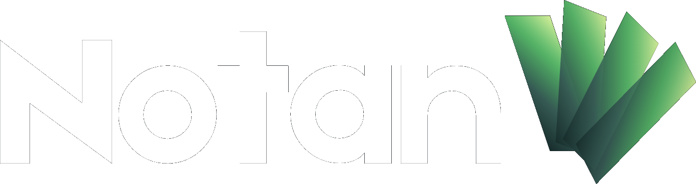

<table cellpadding="16" cellspacing="0" border="0" width="80%">
  <tr>
    <td align="left" colspan="2"><b>Devops Projects</b></td>
  </tr>
  <tr>
    <td align="left" valign="middle" width="200" height="54">
      
    </td>
    <td align="left" valign="middle">
      <b>Covo</b> is a team management tool.
    </td>
  </tr>
  <tr>
    <td align="left" valign="middle" width="200" height="54">
      
    </td>
    <td align="left" valign="middle">
      <b>Nflix</b> is a movie store.
    </td>
  </tr>
  <tr>
    <td align="left" valign="middle" width="200" height="54">
      
    </td>
    <td align="left" valign="middle">
      <b>K8o</b> is a Kubernetes AI healing system.
    </td>
  </tr>
  <tr>
    <td align="left" valign="middle" width="200" height="54">
      
    </td>
    <td align="left" valign="middle">
      <b>MainLine</b> is a self-hosted MLOps platform: contract, gates, canary, rollback.
    </td>
  </tr>
</table>

<table cellpadding="16" cellspacing="0" border="0" width="80%">
  <tr>
    <td align="left" colspan="2"><b>DevTools</b></td>
  </tr>
  <tr>
    <td align="left" valign="middle" width="200" height="54">
      
    </td>
    <td align="left" valign="middle">
      <b>Notan</b> is a calm, offline workspace for the Markdown specs your coding agents build from.
    </td>
  </tr>
</table>

## What I work on

- Infrastructure platforms that carry a workload from prototype to served, monitored, reversible operation.
- Kubernetes operations: rollout control, health detection, automatic remediation.
- Tools that remove repeated plumbing from product teams.

