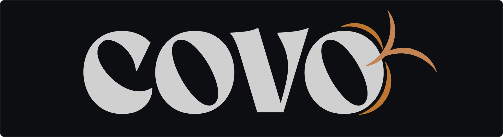
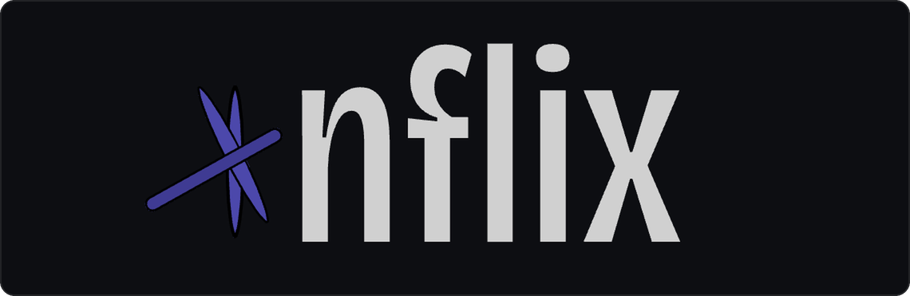
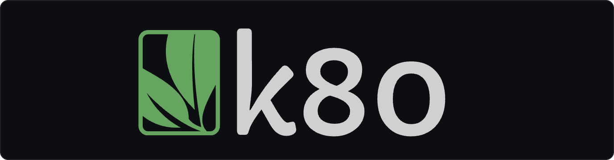
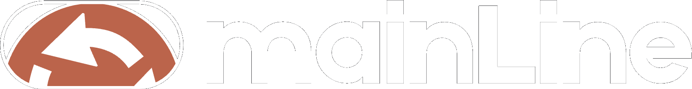

<h1 align="center">Snehal Pradhan</h1>

  <em>Self-hosted platforms. Infrastructure tooling. Systems that stay up.</em>

  
  
  

---

<h2 align="center">DevOps Projects</h2>

  
  
   
  
  

---

## What I work on

- Infrastructure platforms that carry a workload from prototype to served, monitored, reversible operation.
- Kubernetes operations: rollout control, health detection, automatic remediation.
- Tools that remove repeated plumbing from product teams.

## Elsewhere

  

Profile README. Logos in <a href="assets"><code>assets/</code></a> are byte-identical copies of each project's <code>public/logo-readme.png</code>.
